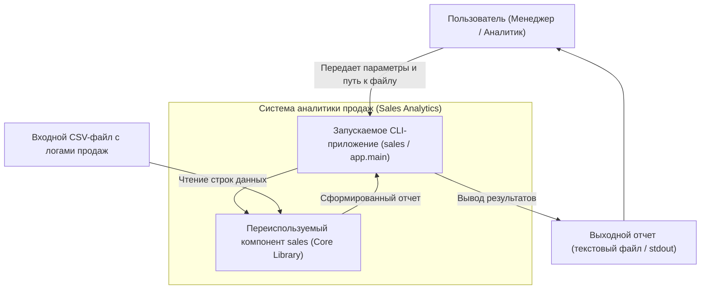
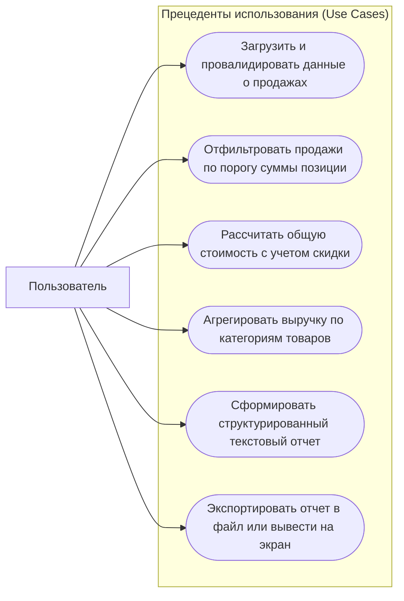
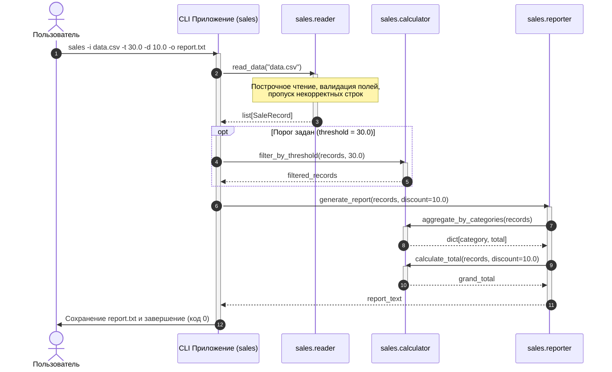

# Архитектурное описание проекта (ARCHITECTURE)

Данный документ описывает архитектуру системы аналитики продаж (`sales`), границы ответственности компонентов, потоки данных и порядок взаимодействия модулей.

---

## 1. Архитектурная концепция и границы ответственности

В соответствии с требованиями инженерного стандарта проект разделен на две строго различимые части:
1. **Переиспользуемый компонент (Core Library `sales`)**:
   - Расположен в `src/sales/`.
   - Не зависит от способа взаимодействия с пользователем (CLI, Web, GUI, очереди сообщений).
   - Содержит доменные сущности (`SaleRecord`), парсер входных данных, калькулятор скидок/порогов, агрегатор по категориям и генератор текстового отчета.
   - Устанавливается как независимый Python-пакет (`pip install .` или из wheel-артефакта).
   - Не имеет внешних сторонних зависимостей в runtime (использует только стандартную библиотеку Python).

2. **Запускаемое приложение (CLI Application `app` / `sales.cli`)**:
   - Точка входа в `app/main.py` и консольная команда `sales`.
   - Отвечает исключительно за разбор аргументов командной строки (`argparse`), валидацию переданных путей, перенаправление вывода (stdout или файл) и возврат стандартных кодов завершения процесса (`0` при успехе, `1` при ошибке).
   - Вся логика вычислений делегируется доменному пакету.

---

## 2. Диаграмма контекста системы (C4 Context)

Диаграмма контекста показывает систему в окружении пользователя и внешних источников/приемников данных:



*Исходник диаграммы также сохранен в [docs/diagrams/context.mmd](diagrams/context.mmd).*

---

## 3. Диаграмма прецедентов (Use-Case Diagram)

Отражает основные пользовательские сценарии, определенные в [docs/DOMAIN.md](DOMAIN.md):



*Исходник диаграммы также сохранен в [docs/diagrams/use_case.mmd](diagrams/use_case.mmd).*

---

## 4. Диаграмма последовательности (Sequence Diagram)

Показывает ключевой сценарий: чтение данных из CSV, опциональная фильтрация по порогу, агрегация по категориям, расчет общей суммы со скидкой и вывод отчета:



*Исходник диаграммы также сохранен в [docs/diagrams/sequence.mmd](diagrams/sequence.mmd).*

---

## 5. Слои и структура пакетов

```text
src/sales/
├── __init__.py       # Публичный фасад библиотеки (экспорт основных функций)
├── models.py         # Доменная модель SaleRecord (немутабельный dataclass с валидацией)
├── reader.py         # Чтение CSV/текстового файла, построчная валидация, отсев битых строк
├── calculator.py     # Чистые функции: calculate_total, filter_by_threshold, aggregate_by_categories
├── reporter.py       # Форматирование итогового отчета по спецификации
└── cli.py            # CLI-интерфейс (argparse, потоки ввода-вывода)
```

Каждый модуль имеет единственную ответственность (Single Responsibility Principle):
- `models.py` не знает о файлах и CLI;
- `reader.py` занимается только парсингом и отсевом некорректных строк;
- `calculator.py` состоит из детерминированных чистых функций без побочных эффектов;
- `reporter.py` преобразует результаты вычислений в текстовый формат;
- `cli.py` обеспечивает внешний интерфейс для операционной системы.
